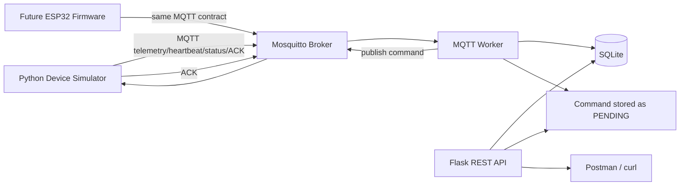

# SmartRoom Monitor

IoT demo backend for ESP32 + DHT22 + LED, with MQTT-first data flow:

ESP32/Simulator -> Mosquitto MQTT -> MQTT Worker -> SQLite -> Flask REST API -> Future Frontend

Current priority: working backend demo with a Python device simulator. Physical ESP32, DHT22, and LED are not available in this iteration.

## Architecture



- Fremware folder: ESP32 firmware marked **NOT TESTED** on physical hardware.
- `simulator/simulate_device.py`: test harness that uses the same MQTT topics/payloads as firmware.
- `backend/worker.py`: separate process consuming MQTT and writing SQLite.
- `backend/app`: modular Flask app with JWT/RBAC, device, telemetry, commands, alerts.
- `broker/`: Mosquitto dev config with username/password and simple ACL.

## Quick start on Windows PowerShell

1. Install Python 3.11+.
2. Create virtualenv and install dependencies:

```powershell
python -m venv .venv
.\.venv\Scripts\python -m pip install -r backend\requirements.txt
```

3. Run Mosquitto with Docker and generate local broker password file:

```powershell
powershell -ExecutionPolicy Bypass -File scripts\setup_mqtt_passwords.ps1
docker compose up -d mosquitto
```

4. Apply migration and seed demo data:

```powershell
cd backend
$env:PYTHONPATH='.'
..\.venv\Scripts\python -m flask --app wsgi:app db upgrade
cd ..
$env:PYTHONPATH='backend'
.\.venv\Scripts\python backend\bootstrap.py
```

Default demo users:
- `admin / Admin@123`
- `operator / Operator@123`
- `viewer / Viewer@123`

Default simulated device: `sim-esp32-001`.

5. Start API:

```powershell
cd backend
$env:PYTHONPATH='.'
..\.venv\Scripts\python -m flask --app wsgi:app run --host 0.0.0.0 --port 5000
```

6. Start MQTT Worker in another terminal:

```powershell
$env:PYTHONPATH='backend'
.\.venv\Scripts\python backend\worker.py
```

7. Start simulator in another terminal:

```powershell
.\.venv\Scripts\python simulator\simulate_device.py --telemetry-interval 2 --heartbeat-interval 2
```

Or use the helper: `powershell -ExecutionPolicy Bypass -File scripts\run_demo.ps1`.

## Demo through REST API

Login:

```powershell
$body = @{ username='admin'; password='Admin@123' } | ConvertTo-Json
$login = Invoke-RestMethod -Method Post -Uri http://localhost:5000/api/v1/auth/login -ContentType 'application/json' -Body $body
$headers = @{ Authorization = "Bearer $($login.access_token)" }
```

Check telemetry:

```powershell
Invoke-RestMethod -Method Get -Uri http://localhost:5000/api/v1/devices/sim-esp32-001/telemetry/latest -Headers $headers
```

Send LED ON:

```powershell
$cmdBody = @{ action='ON' } | ConvertTo-Json
$cmd = Invoke-RestMethod -Method Post -Uri http://localhost:5000/api/v1/devices/sim-esp32-001/commands -Headers $headers -ContentType 'application/json' -Body $cmdBody
$cmd
Start-Sleep -Seconds 2
Invoke-RestMethod -Method Get -Uri "http://localhost:5000/api/v1/commands/$($cmd.id)" -Headers $headers
```

Expected: command state changes `PENDING -> ACKNOWLEDGED` because the simulator receives the command through MQTT and sends an ACK through MQTT.

Force threshold alerts:

```powershell
.\.venv\Scripts\python simulator\simulate_device.py --telemetry-interval 1 --heartbeat-interval 2 --force-alert
```

Then:

```powershell
Invoke-RestMethod -Method Get -Uri http://localhost:5000/api/v1/alerts -Headers $headers
```

## Key files

- [backend/app](/backend/app): Flask app, API, models, services.
- [backend/worker.py](/backend/worker.py): separate MQTT worker.
- [simulator/simulate_device.py](/simulator/simulate_device.py): MQTT device simulator.
- [firmware/smartroom_esp32/smartroom_esp32.ino](/firmware/smartroom_esp32/smartroom_esp32.ino): ESP32 firmware, not hardware-tested.
- [docs/mqtt_protocol.md](/docs/mqtt_protocol.md): topic and payload contract.
- [docs/api.md](/docs/api.md): REST endpoint summary.
- [docs/testing.md](/docs/testing.md): test commands and evidence.

## Status notes

- PASS: Python tests, DB migration, API auth/RBAC, simulator -> MQTT -> worker -> SQLite -> API telemetry, LED command ACK roundtrip, threshold alerts, offline detection.
- NOT TESTED: physical ESP32/DHT22/LED firmware.
- NOT IMPLEMENTED: frontend, AI, OTA, full Mosquitto Dynamic Security integration.
